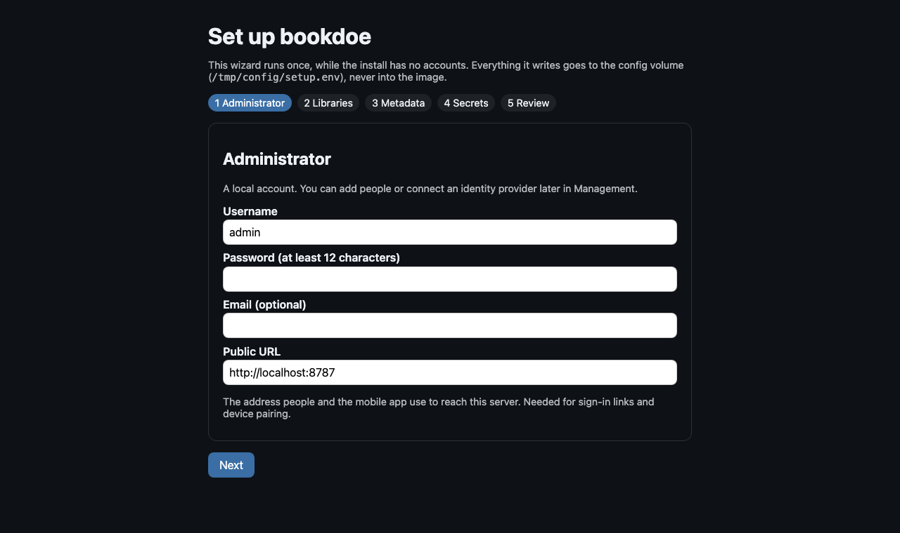
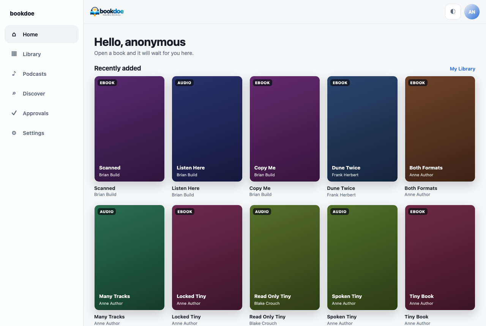

# bookdoe

*Every Story. One Library.* The product name is a setting (`BOOKDOE_APP_NAME`, default `bookdoe`); the repo, containers, database and environment variables keep their internal `bookdoe` names.

Self-hosted library for ebooks and audiobooks: adopt the files you already have,
find what is missing, and read or listen from a browser, an e-reader or the iOS and
Android apps.

bookdoe pairs with **OpenReads**, a small metadata service that reconciles Open
Library, Google Books and AudiobookDB into one canonical record per book. Both run as
containers from one Compose file.

- One **Work** can own an ebook and an audiobook. Existing collections are scanned
  and adopted in place; nothing is moved or renamed unless you ask for a managed
  import.
- Two experiences on one backend: the **Player** at `/` (read, listen, discover,
  request; installable PWA with offline books) and **Management** at `/manage` for
  administrators.
- Accounts: local, API keys, native OIDC (Authentik, Keycloak, Authelia and similar)
  or trusted reverse-proxy headers. Adult and kid account types, per-kid content
  grants, a request and approval workflow.
- Devices: a versioned Player API with revocable device tokens, OPDS 1.x and 2.0
  catalogues, send-to-Kindle, Kobo kepub.
- Operations: scheduled jobs, health probes, online SQLite backups with integrity
  checks, one-time read-only migration from two Readarr instances.
- Native **iOS** (`ios/`) and **Android** (`android/`) apps that also speak Jellyfin
  and Audiobookshelf.

Optional integrations are described in [docs/INTEGRATIONS.md](docs/INTEGRATIONS.md).

## Quick start

Requirements: Docker with the Compose plugin (v2.24 or later), about 1 GB of disk for
the images, and the directories that hold your books.

```sh
git clone <this repository> bookdoe
cd bookdoe
sh install.sh            # asks for paths and a port, generates secrets, starts the stack
```

Then open `http://<host>:8795/setup` and finish the wizard: administrator account,
library roots, optional metadata API keys, where secrets come from. Without a browser:
`docker compose exec bookdoe bookdoe setup`.



Once set up, the web Player at `/` is where you read and listen:



`install.sh --yes` accepts every default and keeps all data under `./data`. Details,
upgrades and uninstall: [docs/INSTALL.md](docs/INSTALL.md). Platform notes:
[Unraid](docs/UNRAID.md) (with a Community Apps template in `unraid/`) and
[Synology](docs/SYNOLOGY.md).

**HTTPS for the iOS app.** The iOS app refuses plain `http://` to non-local hosts
(App Transport Security). On the LAN `http://` works; for anything reachable from
outside, put a reverse proxy with HTTPS in front. See the HTTPS section of
[docs/INSTALL.md](docs/INSTALL.md).

## About this project

bookdoe is a hobby project with best-effort support: issues are read, but there is no
timeline or guarantee. Acquisition features (indexers, download clients, wanted
search) are optional, off by default, and you are responsible for using them lawfully
where you live; see [docs/INTEGRATIONS.md](docs/INTEGRATIONS.md).

## Configuration

| Where | What |
| --- | --- |
| `.env` (root) | host paths, port, PUID/PGID for `docker-compose.yml` (see `.env.example`) |
| `bookdoe/.env` | application settings: secret key, auth mode, OIDC, API keys (see `bookdoe/.env.example`) |
| `/config/setup.env` (inside the config volume) | what the setup wizard wrote; loaded at start, never overriding the environment |
| Infisical (optional) | `BOOKDOE_SECRETS_BACKEND=infisical`; see [docs/SECRETS.md](docs/SECRETS.md) |

No secret is ever baked into an image or committed to this repository; a test and a
gitleaks configuration enforce that (`make secret-scan`).

## iOS app

`ios/` holds a SwiftUI app and the `AlexandriaKit` package (providers for bookdoe,
Jellyfin and Audiobookshelf, Keychain credentials, offline progress sync, downloads).
Build it on a Mac with XcodeGen and Xcode, or let the GitHub Actions workflow run the
tests, a simulator build and an optional TestFlight upload:
[docs/IOS_BUILD.md](docs/IOS_BUILD.md), [docs/IOS_APP.md](docs/IOS_APP.md).
Testing on devices and shipping to TestFlight and Play:
[docs/MOBILE_TESTING_AND_DEPLOYMENT.md](docs/MOBILE_TESTING_AND_DEPLOYMENT.md).

## Android app

`android/` holds the Kotlin and Jetpack Compose app: a pure JVM `core` module (the
same providers, models, offline progress queue and download bookkeeping as the iOS
package, with the same unit tests) and the `app` module (Media3 playback service,
Keystore-backed credentials, WorkManager downloads). Build it with Android Studio or
the Gradle wrapper, or in Docker without an SDK (`android/ci/build.sh`); the GitHub
Actions workflow runs the tests, a debug APK and lint, and can upload a signed
bundle to the Play internal track:
[docs/ANDROID_BUILD.md](docs/ANDROID_BUILD.md), [docs/ANDROID_APP.md](docs/ANDROID_APP.md).

## Development

```sh
make test          # both Python suites (OpenReads ~115 tests, bookdoe ~1500)
make check         # tests, UI gate, compileall, bundle syntax checks, hygiene scan
make secret-scan   # gitleaks when installed, otherwise the Python scanner
make ios-test      # swift test for the iOS package (needs Swift 5.9+)
make android-test  # Android unit tests (JDK 17 + Android SDK, or Docker via android/ci/build.sh)
make android-build # debug APK and lint
```

Each service has its own `requirements.txt`; use two virtual environments (their
FastAPI versions differ). See [CONTRIBUTING.md](CONTRIBUTING.md) and
[CODING.md](CODING.md) for conventions, and [SECURITY.md](SECURITY.md) for reporting
vulnerabilities.

## Documentation

- [Install](docs/INSTALL.md), [Unraid](docs/UNRAID.md), [Synology](docs/SYNOLOGY.md), [Operations](docs/OPERATIONS.md), [Secrets](docs/SECRETS.md)
- [Architecture](docs/ARCHITECTURE.md), [Domain model](docs/DOMAIN_MODEL.md), [Security model](docs/SECURITY.md)
- [Metadata and OpenReads](docs/METADATA.md), [Optional integrations](docs/INTEGRATIONS.md), [Readarr migration](docs/MIGRATION.md)
- [Management, Player, accounts](docs/PLAYER_MANAGEMENT.md), [Player API](docs/PLAYER_API.md), [Compatible players research](docs/COMPAT_PLAYERS.md)
- [iOS app](docs/IOS_APP.md), [iOS build and TestFlight](docs/IOS_BUILD.md)
- [Android app](docs/ANDROID_APP.md), [Android build and Play](docs/ANDROID_BUILD.md)
- [Testing and deploying the mobile apps](docs/MOBILE_TESTING_AND_DEPLOYMENT.md)
- [Architecture decisions](docs/adr/)

## Status

bookdoe is in daily use by its author. Safe to enable: download queue polling,
library file health, the daily backup, housekeeping. Enable deliberately (they call
external providers): metadata refresh, author bibliography discovery. Not yet:
automatic wanted search (it can grab the same release twice; search and grab by hand).

## License

MIT. See [LICENSE](LICENSE).
